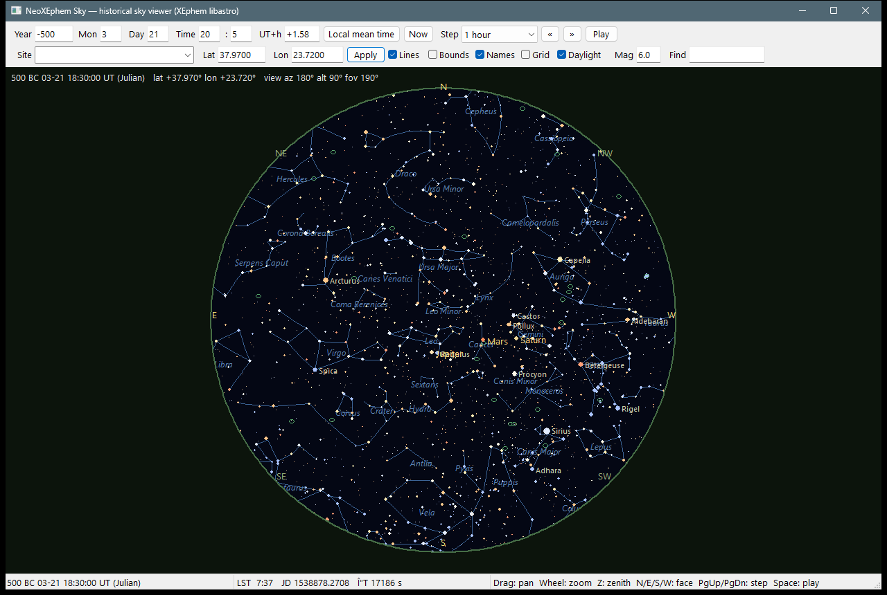
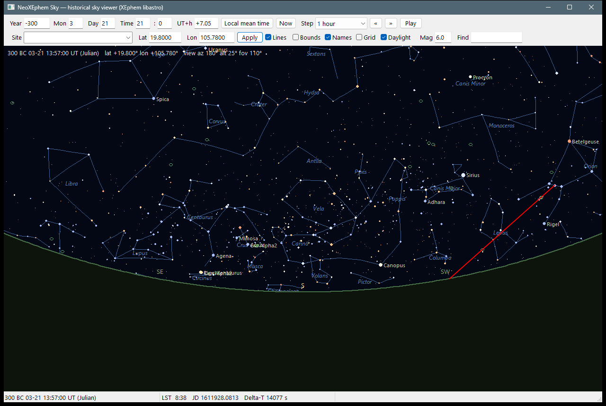
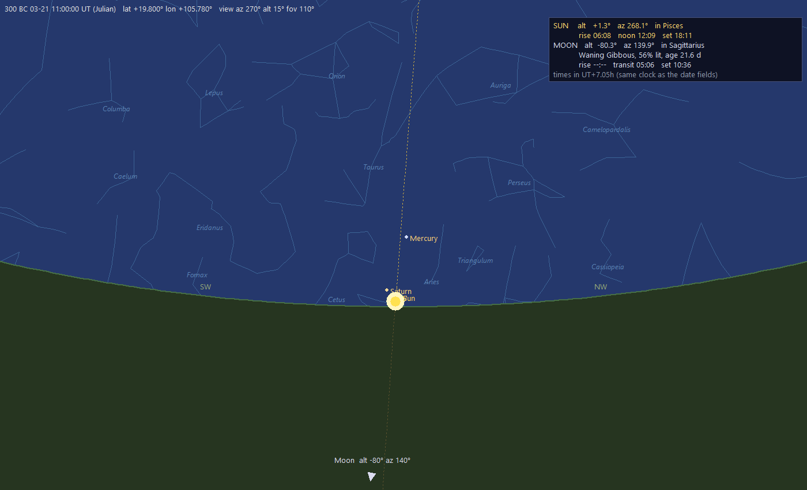
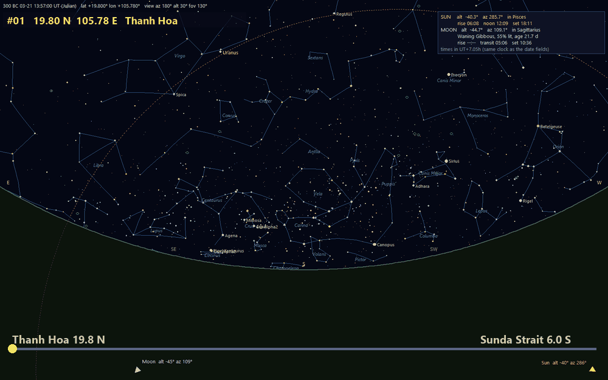
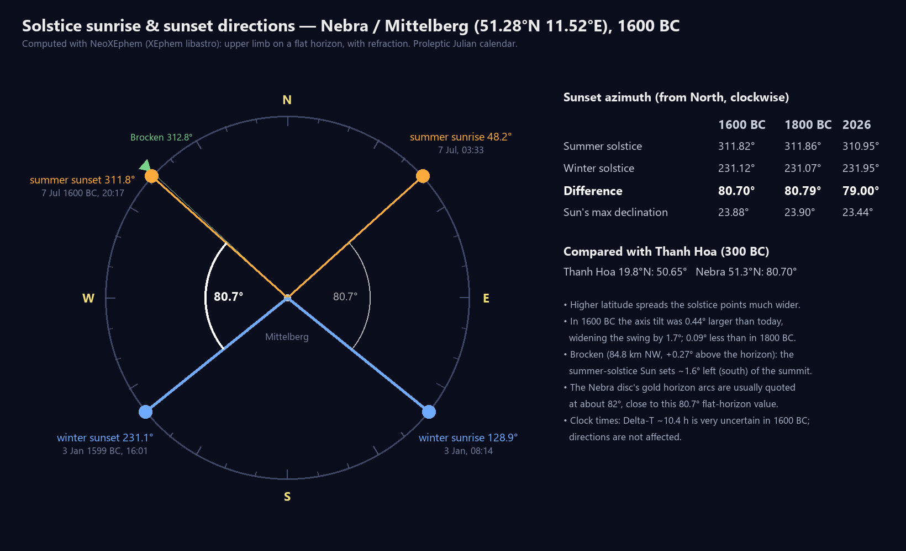

# NeoXEphem Sky for Windows

**See the sky from any place on Earth, on any date: tonight, in 1010 AD, or in 1800 BC.**

NeoXEphem Sky is a native Windows planetarium built on the astronomy engine
(`libastro`) of [XEphem](https://github.com/XEphem/XEphem), the classic
Unix ephemeris program by Elwood Charles Downey. The engine is compiled
natively with MSVC and left unmodified. A new Win32 front end replaces
XEphem's X11/Motif GUI, so it needs no X server, WSL, Cygwin or Docker.



## In memory of Elwood Charles Downey (1955–2026)

Elwood Downey (amateur radio call sign WB0OEW) wrote XEphem and gave it
to the world. For more than three decades it was one of the most capable
free planetarium and ephemeris programs on any platform, used by amateur
astronomers, observatories, educators and satellite watchers. Its
`libastro` engine also became the core of
[PyEphem](https://rhodesmill.org/pyephem/), so his code still computes
positions in countless scripts and research pipelines. In 2021 he released
XEphem under the MIT License, which made this project possible. He was also
the author of HamClock, much loved in the ham radio community.

Elwood Downey passed away in January 2026. Every star, planet, sunrise and
eclipse this program shows is computed by his work. This port is dedicated
to him, with gratitude.

Thanks also to Brandon Rhodes and the contributors who maintain XEphem at
[github.com/XEphem](https://github.com/XEphem/XEphem).

*Clear skies, Elwood.*

## Download

Get `NeoXEphemSky-win64.zip` from the
[latest release](https://github.com/gaiavn-dev/NeoXEphem-Sky/releases/latest),
unzip it anywhere, and run `NeoXEphemSky.exe`. Nothing needs installing.
Keep the `data` folder next to the executables.

| Program | What it is |
|---|---|
| `NeoXEphemSky.exe` | Interactive sky map (Win32/GDI) |
| `neox-sky.exe` | Command line: list what is in the sky at a date and place |

Windows 10 or 11, 64-bit.

## Features

* **Any date, past or future**, with historical year numbering (`-500` = 500 BC,
  no year 0). Dates before 15 Oct 1582 use the Julian calendar, as in XEphem.
* **Any place**: 525 built-in sites from XEphem, or type a latitude/longitude.
* 8,997 stars to magnitude 6.5 (SKY2000), Messier objects, the planets, and
  constellation lines, names and IAU boundaries.
* **Precession, nutation, aberration, refraction and stellar proper motion**,
  so star positions are correct for ancient dates (for example, Thuban is the
  pole star in 2787 BC).
* **Sun and Moon**, always located:
  * rise, transit and set times plus azimuths;
  * the Moon drawn with its true phase shape, and its phase name, % lit and age;
  * edge arrows that point to them when they are off screen;
  * a daylight sky that brightens and hides faint stars by the Sun's altitude.
* Ecliptic and alt-az grid overlays. Time stepping from 1 minute to 100 years,
  with animation.
* Batch rendering: `--view` and `--shot` render images without opening a
  window, for series and animations.

## Using the sky map

```bat
NeoXEphemSky.exe
NeoXEphemSky.exe -500 3 21 18:30 37.97 23.72
NeoXEphemSky.exe -300 6 21 13:00 19.80 105.78 --view 180 30 120 --shot "south.bmp" 1600 1000
```

The optional command line is `YEAR MONTH DAY HH:MM(UT) LAT LON`, with `+N`
and `+E`. `--view AZ ALT FOV` aims the camera in degrees. `--shot FILE W H`
writes a BMP image and exits.

| Control | Action |
|---|---|
| Drag / mouse wheel | Pan / zoom |
| **Z**, **N E S W**, arrow keys | Zenith, face a direction, pan |
| **U** / **M** (or **Sun** / **Moon** buttons) | Turn toward the Sun / Moon |
| **PgUp / PgDn**, « » | Step time back / forward by the chosen step |
| **Space** (or **Play**) | Animate |
| **Find** + Enter | Centre on an object by name (`Sirius`, `Mars`, `M31`, `Thuban`…) |
| Hover / click | Magnitude, alt/az, RA/Dec of date, constellation |

**UT+h** is the offset of the time fields from UT. **Local mean time** sets it
to longitude/15. Use that for historical dates, since time zones did not exist then.

## Using the command line

```bat
neox-sky.exe -7 10 1 18:00 32.54 44.42 3
```

This prints the Sun and Moon (with rise/transit/set and phase) and then every
planet and star brighter than magnitude 3, here at Babylon on 1 Oct 7 BC,
18:00 UT. For each object it gives alt/az, RA/Dec of date and constellation.

## Examples

| | |
|---|---|
|  |  |
| Thanh Hóa, Vietnam, 300 BC, facing south | Sun and Moon overlays at sunset |



*The same moment in 300 BC, seen from 20 places on the 105.78°E meridian.*



*Summer and winter solstice sunset directions at the Mittelberg (Nebra sky
disc site) in 1600 BC: 80.7° apart, compared with 79.0° today.*

## Building from source

You need Visual Studio 2019/2022 (or Build Tools) with the C++ workload, plus
CMake 3.20 or later and Ninja.

```bat
build.bat
```

Output goes to `build\`, and the catalogs are copied to `build\data\`. The build also produces
`astrotest.exe`, XEphem's own regression test. Its output must match
`third_party/xephem/tests/output.expected` byte for byte, and CI checks this
on every push.

```
CMakeLists.txt        build definition
build.bat             finds MSVC via vswhere, configures and builds
compat/unistd.h       the only shim libastro needs for MSVC
src/skycore.*         catalogs, sites, figures, ephemeris, alt/az, rise/set (wraps libastro)
src/skywin.c          the Win32 sky map
src/skycli.c          the command-line tool
third_party/xephem/   XEphem libastro + regression test, vendored unmodified
data/                 XEphem star catalog, Messier list, sites, constellation figures
docs/                 analysis notes and example images
```

[docs/ANALYSIS.md](docs/ANALYSIS.md) has the reverse-engineering notes on
XEphem, the options for porting the full Motif GUI, and the accuracy limits.

## Accuracy for historical dates

* Planets use VSOP87 / Chapront theories, and the Moon uses Moshier's theory
  (valid about 1369 BC to 3000 AD).
* Star positions use linear proper motion from the SKY2000 catalog. This is
  good for naked-eye work over a few thousand years.
* **Delta-T** (the slowing of Earth's rotation) uses Morrison & Stephenson
  (2004). Far in the past it is uncertain by hours, which shifts *clock times*
  but not the overall look of the sky or the rise/set directions.

## License

MIT, see [LICENSE](LICENSE). The XEphem sources and data in
`third_party/xephem/` and `data/` are Copyright (c) 1990-2020 Elwood Charles
Downey and distributed under the MIT License. This project is not affiliated
with or endorsed by the XEphem maintainers.
